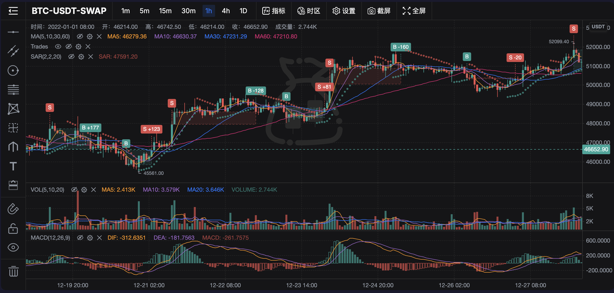

<h1 align="center">TradingChest</h1>
<p align="center">专业级交易图表库，对标 TradingView 图表能力。基于 KLineChart 构建。</p>

<div align="center">

[](https://www.npmjs.com/package/trading-chest)
[](dist/index.d.ts)
[](LICENSE)

[English](README.md) | **中文** | [日本語](README.ja.md) | [한국어](README.ko.md)

</div>

<p align="center">
  
</p>

## 0.14.0 本地候选

七种既有线条／通道／矩形支持附着文字；稳定 ID 的重叠候选列表和明确根数／价格／tick 的精确平移用于密集编辑，第三方工具声明同样能力。正文、修改与保存沿原确认和撤销链。工具仍为 56 项，KLineCharts 维持 10.1.0，文档格式不升版。见 [0.14 升级说明](docs/upgrade/0.14.0.md)与[绘图使用](docs/drawings.md#drawing-expressiveness)。本地验收已按获批性能预算完成，尚未发布到 npm；下方固定安装命令仍指向已发布稳定版。

## 0.13.0 本地候选

新增四种本图确认画线的 close 穿越提醒、实时／回放独立状态、可移植规则及无 DOM 的 `trading-chest/alerts` 评估器。曲线增加端点标记与两端直弦闭合背景。规则默认只在内存中，单独保存布局不包含提醒，页面关闭后停止监控。见[0.13 升级说明](docs/upgrade/0.13.0.md)。当前仅为本地候选，下面的固定 npm 安装命令仍指向已发布稳定版；正式发布另行执行。

## 0.12.0 绘图精修

单选与多选编辑器按工具声明提供共同样式控件并显示混合值。锚定 VWAP 支持最多三组标准差／百分比带，FRVP 增加显示位置与级别样式；新增三种屏幕投影曲线工具，目录扩展至 56 项。第三方工具通过 peer 的 `registerOverlay` 注册，库不依赖特定宿主后端。参见 [0.12 升级说明](docs/upgrade/0.12.0.md)和[绘图使用](docs/drawings.md)。数据接入与持久化格式保持不变，发布状态以 npm registry 为准。

## 0.11.0 量价绘图

锚定 VWAP 与固定区间成交量分布使用每张图已确认的 OHLCV，明确采样与覆盖边界。虚拟对象树支持分组折叠和经过确认的拖动／键盘排序。参见 [0.11 升级说明](docs/upgrade/0.11.0.md)与[量价绘图契约](docs/drawings.md#volume-drawings)。

## 0.10.0 绘图工作台

统一 51 工具目录、多行文字、精确坐标与控制点、多选分组、模板偏好，以及本图／工作台／宿主共享。后端写入保留原确认权威，布局升级 ChartLayoutV4／WorkspaceDocument v2，旧原件纯读取迁移。参见[绘图使用](docs/drawings.md)、[升级说明](docs/upgrade/0.10.0.md)与[独立示例](examples/drawing-workbench)。本地源码／产物不代表已经发布，也不代表所有 TradingView 工具等价。

## 0.8.0 数据接入与命名工作台

支持带命名空间的 KLineChart 模板、每图指标目录与按 ID 操作的真实实例，参数含数字／选择器／布尔开关，同名实例互不串改。外部线、正负柱、价格带、只读事件和有序标签面板接受宿主显式快照，落实 scope token、dataBasis 与回放 availableAt 规则。工作台尺寸／主题／语言／工具栏由宿主配置。

历史读取使用 before/countBack 或完整 range，请求明确返回穷尽边界及可选来源元数据。图表提供已确认数据／连接状态及 retryData。命名工作台注入异步分区存储并校验 revision，内置 IndexedDB 与显式旧布局导入；工作台 v1、单图 v3 格式不变。

见 [0.8.0 迁移说明](docs/upgrade/0.8.0.md)、[数据接入](docs/data-access.md)、[API](docs/api.md)、[0.7.0 升级说明](docs/upgrade/0.7.0.md)和[独立 tarball 示例](examples/analysis-sdk/README.md)。库不依赖 EvoTrader 后端或凭证，示例为明确隔离合成数据；业务计算、数据、存储和操作回调由宿主负责。

`npm run test:package` 验证安装后的 ESM／CJS／UMD／CSS，并在 Chromium 操作独立示例。`npx playwright install chromium && npm run test:browser` 自行管理空闲端口及包内服务，证据写入 test-results。CI 保留 Node 22／24 原检查，新增包／浏览器／文档构建。

## 特性

### 技术指标（73+）

| 分类 | 数量 | 示例 |
|------|------|------|
| 趋势 | 21 | MA, EMA, BOLL, Ichimoku, SuperTrend, Alligator, KAMA, HMA... |
| 波动率 | 9 | Keltner Channels, Donchian Channels, ATR, Bollinger Band Width... |
| 成交量 | 12 | VOL, VWAP, MFI, CMF, Klinger Oscillator, Elder Ray... |
| 动量 | 26 | MACD, RSI, KDJ, StochRSI, ADX, Aroon, Fisher Transform, PPO... |
| 其他 | 2 | Pivot Points, ZigZag |

- 分类 Tab 快速筛选（趋势/波动率/成交量/动量/其他）
- 实时搜索过滤
- 指标参数可自定义
- 指标懒加载注册，加速启动

### 绘图工具（56）

| 分类 | 工具 |
|------|------|
| 线条 | 水平线、垂直线、趋势线、射线、线段、箭头、价格线、平行线、价格通道 |
| 斐波那契 | 回调线、线段、圆环、螺旋、速度阻力扇、趋势扩展 |
| 波浪 | 三浪、五浪、八浪、任意浪、ABCD、XABCD |
| 几何 | 圆、矩形、三角形、平行四边形 |
| 形态 | Andrew's Pitchfork、Schiff Pitchfork、线性回归、回归通道、Gann Box |
| 测量 | 价格区间、时间区间、综合测量 |
| 标注 | 文字标注、标注气泡、便签、自由画笔 |
| 交易 | 做多持仓、做空持仓（入场/止损/止盈可视化 + 盈亏比） |

- 所有工具支持 hover tooltip 提示
- 文字类工具支持输入文字 + 右键编辑
- 七种线条／通道／矩形支持可选附着文字；模板只保样式与参数，不复制正文
- 右键或触摸长按可选择重叠绘图；绘图管理按已加载真实 K 线、价格值或明确 tick 精确平移可用对象
- 文字标签与测量标签共用 KLineCharts 的文字绘制和点击范围计算，保留字体、对齐及内边距样式。
- **选中绘图后弹出浮动属性工具栏**（对标 TradingView）：
  - TradingView 风格 9×8 调色板（72 色）
  - 线宽选择器（1–4px 可视化预览）
  - 线型选择器（实线/虚线/点线）
  - 锁定/删除快捷按钮

### 图表类型（8 种）

蜡烛实心、蜡烛空心、涨空心、跌空心、OHLC、面积图、**Heikin Ashi**、**Baseline**

### 价格报警

- 在指定价位添加/移除报警线
- 价格穿越报警线时触发回调
- 图表上显示报警线 overlay
- 实时和回放模式均可用

### 品种对比

- 叠加额外品种，归一化为百分比变化
- 自动跨品种时间戳对齐

### K 线回放

- 逐根回放历史数据
- 播放/暂停/单步前进/单步后退/跳转
- 可调速度（0.5×–16×）
- 回放期间报警系统正常工作

### 交易可视化

- 在图表上叠加买卖标记（来自交易记录）
- 点击交易标记触发回调
- 集成 `IndicatorClickDetector`

### 设置面板

- 蜡烛图类型选择
- 涨/跌颜色自定义（颜色选择器）
- 价格轴类型（线性/百分比/对数）
- 十字光标显隐（水平/垂直独立控制）
- 网格线、最高/最低价标记、提示框类型
- 设置项分组显示（蜡烛图/坐标轴/网格与光标）

### 其他功能

- **键盘快捷键**：15+ 默认绑定（Alt+T 趋势线、Alt+F 斐波那契等），可完全自定义
- **5 种预设主题**：暗色、亮色、午夜蓝、经典（TradingView 风格）、高对比
- **数据导出**：CSV（可见区间/全量）、截图（PNG/JPEG）
- **布局持久化**：单图沿用 localStorage，命名工作台通过异步适配器／IndexedDB 保存、另存、切换、重命名和删除
- **国际化**：中文 (zh-CN)、英文 (en-US)
- **时区**：14 个时区支持

## 安装

```bash
npm install trading-chest@0.12.0 klinecharts@10.1.0
```

## 使用

```typescript
import { KLineChartPro } from 'trading-chest/chart'
import 'trading-chest/dist/trading-chest.css'

// hostHistory is the host adapter described in the data-access guide.
const chart = new KLineChartPro({
  container: document.getElementById('chart'),
  symbol: {
    ticker: 'BTC-USDT',
    name: 'Bitcoin',
    exchange: 'Binance',
    pricePrecision: 2,
    volumePrecision: 4,
  },
  period: { multiplier: 1, timespan: 'day', text: '1D' },
  datafeed: {
    searchSymbols: search => hostHistory.searchSymbols(search),
    getHistoryKLineData: async (symbol, period, query, context) => {
      // Read actual host history; confirm exhaustion only from provider evidence.
      return hostHistory.read(symbol, period, query, context?.signal)
    },
    subscribe: (symbol, period, callback) => hostHistory.subscribe(symbol, period, callback),
    unsubscribe: (symbol, period) => hostHistory.unsubscribe(symbol, period),
  },
  theme: 'dark',
  locale: 'zh-CN',
})

// 使用完毕时销毁
// chart.dispose()
```

## API

### 构造选项

```typescript
interface ChartProOptions {
  container: string | HTMLElement
  symbol: SymbolInfo
  period: Period
  datafeed: Datafeed
  styles?: DeepPartial<Styles>
  watermark?: string | Node
  theme?: string              // 默认: 'light'
  locale?: string             // 默认: 'zh-CN'
  drawingBarVisible?: boolean // 默认: true
  periods?: Period[]
  timezone?: string           // 默认: 'Asia/Shanghai'
  mainIndicators?: string[]   // 默认: ['MA']
  subIndicators?: string[]    // 默认: ['VOL']
  onIndicatorClick?: (event: IndicatorClickEvent) => void
  onAlertTrigger?: (event: AlertEvent) => void
}
```

### 实例方法

```typescript
// 主题
chart.setTheme('dark' | 'light')
chart.getTheme(): string

// 样式
chart.setStyles(styles: DeepPartial<Styles>)
chart.getStyles(): Styles

// 语言
chart.setLocale('zh-CN' | 'en-US')
chart.getLocale(): string

// 时区
chart.setTimezone('Asia/Shanghai')
chart.getTimezone(): string

// 标的 / 周期
chart.setSymbol(symbol: SymbolInfo)
chart.getSymbol(): SymbolInfo
chart.setPeriod(period: Period)
chart.getPeriod(): Period

// 内部图表实例（用于自定义 overlay 操作）
chart.getChart(): Chart | null

// 数据导出
chart.exportCSV(filename?: string)
chart.exportAllCSV(filename?: string)
chart.exportScreenshot({ format?, backgroundColor?, filename? })

// 快捷键管理
chart.getShortcutManager(): KeyboardShortcutManager

// 报警
chart.addAlert({ id, price, condition, color? })
chart.removeAlert(id: string)
chart.getAlerts(): AlertConfig[]
chart.feedPrice(price: number)     // 传入实时价格触发报警检测

// 品种对比
chart.addComparison(symbol: SymbolInfo, datafeed: ComparisonDatafeed): Promise<ComparisonHandle>
chart.removeComparison(handleId: string)
chart.cancelComparison(handleId: string)
chart.getComparisons(): ComparisonState
chart.resetComparisonRange(): Promise<void>
chart.refreshComparisons(): Promise<void>

// K 线回放
chart.startReplay(startPosition?: number)
chart.stopReplay()
chart.getReplayEngine(): ReplayEngine | null

// 交易可视化
chart.createTradeVisualization(trades: TradeRecord[], paneOptions?)
chart.getClickDetector(): IndicatorClickDetector

// 生命周期
chart.dispose()
```

### 导出模块

```typescript
import {
  KLineChartPro,
  DefaultDatafeed,
  loadLocales,

  // 主题
  themePresets, getThemeByName,

  // 数据导出
  exportToCSV, exportAllToCSV, exportScreenshot,

  // 布局持久化
  saveLayoutV3, loadLayoutV3, deleteLayoutV3, listLayoutsV3,

  // 快捷键
  KeyboardShortcutManager,

  // 指标
  indicatorCategories, indicatorRegistry,

  // 报警
  AlertManager,

  // 对比
  normalizeToPercent,

  // 回放
  ReplayEngine,
} from 'trading-chest'
```

## 技术栈

- **渲染引擎**: [KLineChart](https://github.com/klinecharts/KLineChart) 10.1.0（Canvas，高性能）
- **UI 框架**: [Solid.js](https://www.solidjs.com/)（响应式，轻量）
- **构建工具**: [Vite](https://vitejs.dev/)（ESM + UMD 双格式输出）
- **语言**: TypeScript（项目代码零 `@ts-expect-error`）
- **测试**: Vitest（211 个测试，18 个测试文件）

## 构建

开发与测试使用 Node.js 22.22.2+（22.x）或 24.15.0+（24.x），与 jsdom 的运行要求保持一致。

```bash
npm ci
npm run build       # 完整构建（JS + CSS + .d.ts）
npm run test        # 运行测试
```

构建产物：
- `dist/trading-chest.js` — ES Module（~291KB，gzip ~81KB）
- `dist/trading-chest.umd.js` — UMD
- `dist/trading-chest.css` — 样式（~42KB）
- `dist/index.d.ts` — TypeScript 声明

## 源自

Fork 自 [KLineChart Pro](https://github.com/klinecharts/pro)，在此基础上大幅扩展：

- 45+ 自定义技术指标 + 懒加载注册表
- 13+ 绘图工具（测量、标注、交易持仓可视化）
- 绘图选中后浮动属性工具栏（调色板、线宽/线型、锁定、删除）
- 键盘快捷键系统、主题预设、数据导出、布局持久化
- 价格报警系统（实时 + 回放双模式）
- 品种对比叠加（归一化百分比）
- K 线回放引擎（单步/播放/调速）
- 交易可视化 + 点击检测
- 指标面板分类搜索
- 设置面板分组 + 颜色选择器
- `dispose()` 释放自有资源；浏览器验证重复卸载，并记录可用的堆趋势证据

## 许可证

Apache License 2.0
